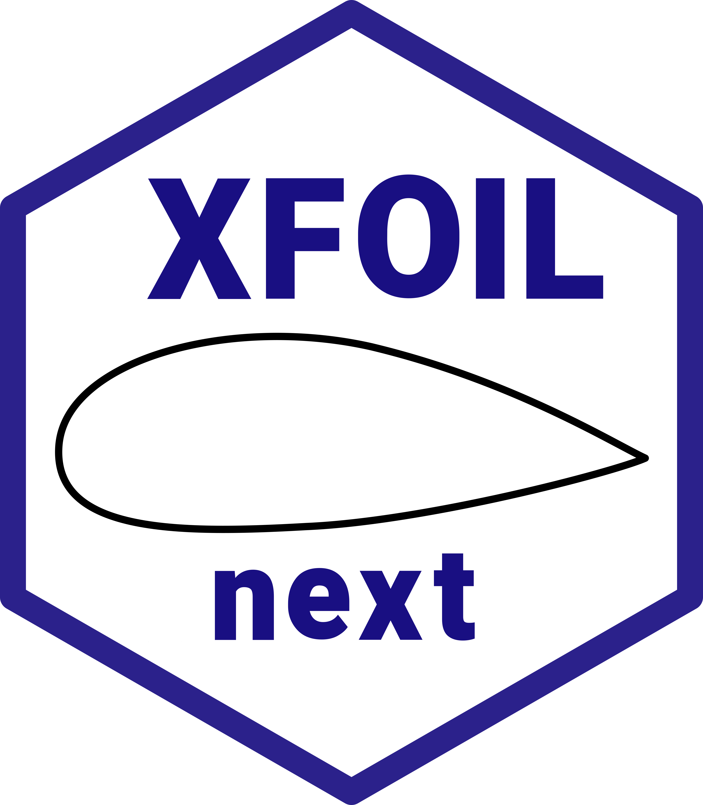
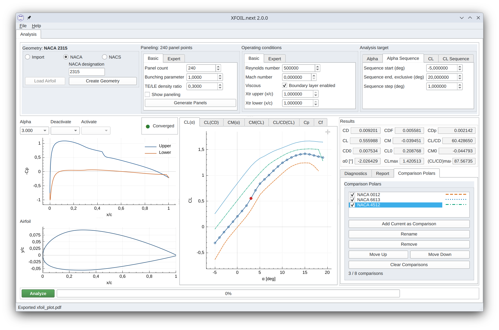

<p align="center">

</p>

<p align="center">
<strong>A modern C++ implementation of XFOIL for aerodynamic analysis and design</strong>
</p>

<p align="center">
<a href="https://github.com/of33/XFOIL.next/actions/workflows/build-and-test.yml">

</a>
&nbsp;&nbsp;
<a href="https://github.com/of33/XFOIL.next/releases/latest">

</a>
&nbsp;&nbsp;
<a href="https://doi.org/10.5281/zenodo.24046163"></a>
&nbsp;&nbsp;
<a href="LICENSE">

</a>
</p>

# XFOIL.next

**Version 2.0.0**

XFOIL.next is a C++20 implementation of the XFOIL airfoil analysis and design
method. It combines the complete established command-line workflow with a
standalone graphical analysis application. The numerical behaviour is
validated directly against the original Fortran sources and the reference
Fortran binary.

<p align="center">

</p>

XFOIL.next 2.0.0 provides two user-facing programs:

- **XFOIL.next GUI** (`xfoil.next`, `xfoil.next.exe`) for the standalone
  Analysis workflow;
- **XFOIL.next CLI** (`xfoil.next-cli`, `xfoil.next-cli.exe`) for the complete
  command-line and batch workflow.

The GUI and CLI are separate programs and separate package sets. XFOIL.next is
licensed under [GPL-3.0-or-later](LICENSE). See [Quick start](#quick-start) and
[Building and testing](docs/building-and-testing.md) for build and start
instructions.

## Motivation

XFOIL.next builds on the enduring aerodynamic work embodied in XFOIL.
Its purpose is to provide a modern, reliable, and understandable C++
foundation for teaching, continued development, and straightforward use,
while preserving full respect for the original authors' scientific and
engineering achievement.

The project aims to:

- offer a maintainable C++20 codebase with clear layering and a readable
  architecture suited for study and extension;
- preserve numerical continuity through a bundled Fortran reference
  corpus and systematic regression validation against the original
  implementation;
- make the tool easy to use from the command line, in batch mode, or
  through the public C++ session API;
- provide a solid base for future development without altering the
  physical and numerical foundations established by the original authors.

XFOIL is the work of Mark Drela and Harold Youngren. The original
sources and their notices are retained unmodified under `fortran-src/xfoil-6.99/`.
See [NOTICE](NOTICE) for full attribution and provenance details.

## What it provides

- a standalone Qt 6.12.0 **XFOIL.next GUI** for the Analysis workflow:
  airfoil import and NACA/NACS geometry, paneling, operating conditions,
  alpha/CL single points and sequences, Cp/Cf/scalar plots, operating-point
  selection and activation, comparison polars, reports, and exports for
  airfoil data and DXF, Cp and polar data, and plots;
- the complete canonical non-graphical XFOIL command set: airfoil and
  panel geometry, NACA generation and file import, inviscid and viscous
  analysis, boundary-layer / transition / wake / interaction numerics,
  single-point and alpha/CL sequences, polar accumulation and reference
  polars, polar save and binary dump files, file and geometry exports,
  settings via `xfoil.def` / `WDEF` / `RDEF`, GDES and CAMB, MDES and QDES,
  VPAR boundary-layer parameters, flap state and hinge moments, and the
  remaining TOP and OPER commands;
- a modern in-memory C++20 API: the stateful `xfoil::Session` and the
  one-shot `xfoil::analyze()`, with owning result value types;
- optional synchronous progress reporting and a separate cancellation
  token;
- public results for Cp and boundary-layer Cf, including the owning
  skin-friction distribution, and drag results `CD`, `CDp`, `CDF` and
  `CDv`;
- complete scalar sequence-point results with `CD`, `CDp`, `CDF`, `CDv` and
  the executed iteration count;
- optional owning detailed alpha and CL sequences with the full Cp surface
  and, for viscous points, the Cf distribution and CDF per executed point,
  without a second solver run or interpolation;
- an owning in-memory polar value and pure PolarText encode/decode adapter
  for imported and comparison polars, without file or session references;
- installable static and shared C++ libraries with public headers and
  pkg-config metadata;
- a memory-only library contract with isolated sessions, no application
  file/console/environment/process operations during API calls, and an
  armed no-I/O proof; concurrent use of one session is not supported;
- the native interactive XFOIL command-line interface;
- a native non-interactive batch mode that reuses the same command
  interpreter, session layer, and numerical core;
- deterministic handling of unavailable plotting and cursor commands.

## Library API

`xfoil::Session` is the stateful in-memory API. The host loads or generates
geometry, configures paneling and analysis, then runs alpha or CL points and
alpha or CL sequences in the same session. `xfoil::analyze()` runs one point on
a temporary session for one-shot use. The compatibility facades
`xfoil::XFoil` and `xfoil::XFoilSession` remain available.

Results are owning value types. `OperatingPointData` carries the scalar
coefficients, convergence data, an optional panel-node Cp distribution and
an optional boundary-layer-station Cf distribution. A live
`xfoil::PolarPoint` carries the compact sequence scalars and status without
Cp or Cf containers. `Session::solveDetailedAlphaSequence` optionally keeps
the complete owning `OperatingPointData` for every executed sequence point,
including Cp and valid viscous Cf, while the compact
`Session::solveAlphaSequence` remains available.

The drag fields are distinct:

- `CD` is the total drag coefficient;
- `CDp` is the pressure/form-drag coefficient;
- `CDF` is the canonical friction-drag coefficient from the final VISCAL
  state, never reconstructed as `CD - CDp`;
- `CDv` is the XFOIL total viscous-drag column, not the friction-only
  `CDF`.

Progress is optional and synchronous. Cancellation uses a separate
`xfoil::CancellationToken`; callback failure and cancellation are distinct.
The library performs no file or console I/O. Separate sessions have isolated
logical state; concurrent use of one session is not supported.

## What it deliberately does not provide

The 2.0.0 GUI delivers the Analysis workflow. It is not a general
geometry-design or scripting frontend and does not provide:

- a Geometry-Design or Camber-Design workflow;
- MDES or QDES;
- Cf or boundary-layer export;
- a project file format or global persistence of analysis state;
- an SDK or additional binary add-on package;
- additional workflow tabs beyond Analysis.

The CLI has no graphical backend. X11 plotting, graphical cursor interaction
and PostScript/hardcopy output are not implemented there. Pure plot and cursor
commands are recognized and report:

```text
Plotting is not available in this build.
```

The standalone GUI provides its own analysis plots, but it is not a
replacement for the original XFOIL plot and cursor command set.

This is a port of XFOIL, not an independent re-derivation of the
solver, and it is not a bit-identical reproduction of every Fortran build
variant (see [known differences](docs/known-differences.md)).

## Quick start

Build (default target is a release build):

```sh
make            # release build, CLI at bin/release/xfoil.next-cli
make debug      # debug build,  CLI at bin/debug/xfoil.next-cli
make library    # release static + shared library under build/release/lib
make install DESTDIR=/tmp/stage PREFIX=/usr
```

`BINROOT` is configurable (default `bin`); alternative toolchains should use
their own root, for example `BINROOT=bin/clang`. Product programs are written
below `bin/<mode>/`; intermediate objects, tests, generated files and
libraries remain below `build/`.

Run the interactive CLI:

```sh
bin/debug/xfoil.next-cli                 # interactive session
bin/debug/xfoil.next-cli profile.dat     # interactive session with a startup profile
bin/debug/xfoil.next-cli < commands.txt  # drive the session from stdin
```

Run the test suites:

```sh
make test         # full C++ test suite
make test-batch   # native batch-mode suite
make test-library-isolation
make test-library-progress
make test-library-skin-friction
make test-library-noio        # Linux armed no-I/O proof
make test-library-concurrency
make library-demo                 # standalone staged-library demo
make test-library-demo            # demo integration tests
```

Build the standalone GUI with the supported Qt 6.12.0 kit:

```sh
source scripts/setup-gui-build.sh /path/to/Qt/6.12.0/gcc_64
make gui-check-qt
make gui-app
make test-gui
```

The equivalent explicit environment uses `QT_ROOT`, `PATH`, `LD_LIBRARY_PATH`
and `QT_PLUGIN_PATH`; `make gui-check-qt` reports the resolved Qt root, version,
tools and platform. `make gui-app` writes `bin/debug/xfoil.next` and
`bin/release/xfoil.next`; `make run-gui` starts the debug application.

On Windows, use the MSYS2 UCRT64 shell and `scripts/setup-gui-build.sh`; the
PowerShell helper `scripts/setup-gui-build.ps1` prepares the same Qt variables
for child processes:

```powershell
. .\scripts\setup-gui-build.ps1 -QtRoot 'C:\Qt\6.12.0\mingw_64'
```

Start the GUI:

```sh
bin/release/xfoil.next
```

```bat
bin\release\xfoil.next.exe
```

The GUI provides the standalone Analysis workflow described above. The CLI
remains a separate console program. See
[packaging/gui](packaging/gui/README.md) for GUI package build details and
[building and testing](docs/building-and-testing.md) for the complete build
instructions.

### GUI exports

The File menu keeps airfoil exports separate from result-plot exports:

- **Export Airfoil** provides **Data...** (`.dat`), **DXF...**, and the
  airfoil view as **PNG...**, **PDF...** or **SVG...**.
- **Export Active Plot** provides the current result plot as **PNG...**,
  **PDF...** or **SVG...**.

Airfoil data export uses `.dat` as the default extension. If the selected
name does not end in `.dat` (case-insensitive), the extension is appended.
Another existing extension is preserved:

```text
airfoil       -> airfoil.dat
airfoil.DAT   -> airfoil.DAT
airfoil.txt   -> airfoil.txt.dat
```

Airfoil plot exports show the same view as the GUI. Open profile trailing
edges are not closed by an artificial line in the airfoil view or in its PNG,
PDF and SVG exports; DXF output remains open.

Comparison polar visibility is controlled by the checkbox of each list entry.
Rename a stored polar with inline editing, F2 or a double-click. Previously
loaded airfoils remain available under **File > Recent Airfoils**.

## Packages

The 2.0.0 distribution separates the CLI and GUI into four packages:

```text
CLI, Linux x86-64:
XFOIL.next-2.0.0-linux-x86_64.tar.xz

CLI, Windows x86-64:
XFOIL.next-2.0.0-windows-x86_64.zip

GUI, Linux x86-64:
XFOIL.next-GUI-2.0.0-linux-x86_64.AppImage

GUI, Windows x86-64:
XFOIL.next-GUI-2.0.0-windows-x86_64.zip
```

Published binary packages are available from the
[GitHub Releases page](https://github.com/of33/XFOIL.next/releases). The CLI
and GUI are separate downloads. The `XFOIL.next-2.0.0-SHA256SUMS` file
contains the SHA-256 values for the four product packages.

### Linux GUI package

The GUI package is an AppImage built and tested on Ubuntu 24.04 x86-64 with
GCC 13.3.0 and Qt 6.12.0. It contains the Qt runtime and plugins; a separate
Qt installation is not required. Make it executable, then start it:

```sh
chmod +x XFOIL.next-GUI-2.0.0-linux-x86_64.AppImage
./XFOIL.next-GUI-2.0.0-linux-x86_64.AppImage
```

No compatibility promise is made for older-glibc systems. The AppImage
contains the GUI only; the CLI is a separate download.

### Windows GUI package

Extract the complete ZIP. Do not copy only `xfoil.next.exe` out of the
package: the executable needs the Qt libraries, plugins and MinGW runtime in
the same extracted directory.

Portable use:

```text
Extract the complete ZIP and run xfoil.next.exe from the extracted folder.
```

Optional per-user installation:

```bat
Install XFOIL.next GUI.cmd
```

The installer copies the complete runtime to:

```text
%LOCALAPPDATA%\Programs\XFOIL.next GUI
```

It creates Desktop and Start Menu shortcuts and requires no administrator
rights. Uninstall through **Uninstall XFOIL.next GUI** in the Start Menu or
through `Uninstall XFOIL.next GUI.cmd` in the installation folder. The
uninstaller removes only the managed installation and its shortcuts. There is
no automatic taskbar or Start pinning. MSI, MSIX and system-wide installation
are not provided.

The Windows GUI executable uses the Windows GUI subsystem and therefore does
not open a console window. The CLI remains a console application.

### CLI packages

The CLI packages contain exactly `LICENSE`, `NOTICE` and one executable. The
Linux executable statically includes libstdc++/libgcc, is built natively on
Ubuntu 24.04 with GCC 13.3.0, and requires GLIBC 2.38 symbols; no older-glibc
compatibility is promised. The Windows executable statically includes the
MinGW-w64 runtime and requires the Windows UCRT, but no MSYS2/MSYS runtime
DLLs. No library SDK binary packages are included.

The published 1.2.1 release used the corresponding CLI-only assets:

```text
XFOIL.next-1.2.1-linux-x86_64.tar.xz
XFOIL.next-1.2.1-windows-x86_64.zip
XFOIL.next-1.2.1-SHA256SUMS
```

Build and packaging details are documented in
[packaging/portable](packaging/portable/README.md) and
[packaging/gui](packaging/gui/README.md).

## Library artifacts and consumption

`make library` writes the static and shared artifacts below `build/<mode>/lib`:

| Platform | Static | Shared |
| --- | --- | --- |
| Linux | `libxfoil_next.a` | `libxfoil_next.so` |
| Windows | `libxfoil_next_static.a` | `xfoil_next.dll` with import library `libxfoil_next.dll.a` |

Supported consumption modes are:

- direct linking against the build-tree artifacts;
- installation into a local prefix;
- staged installation through `DESTDIR` for testing and packaging;
- optional pkg-config metadata (`xfoil-next.pc`);
- explicit include and library paths without pkg-config.

A global installation is not required. See
[building and testing](docs/building-and-testing.md) and the
[public API](docs/public-api.md) for the complete commands.

## Library user manual

The complete guide to the embedded C++20 library is available as
[Library User Manual (PDF)](XFOIL.next-Library-Manual.pdf). It covers the
in-memory API, build and installation, static and shared linking, the
no-I/O contract, session isolation, and the standalone demo.

## Standalone demo

The standalone consumer in [library-demo](library-demo/README.md) builds only
against an installed package. It reads an airfoil profile itself, passes
the coordinates through public in-memory values, runs an alpha sequence
and a specified-CL point in the same session, and writes structured
results to stdout. The library still performs no file or console I/O.

```sh
PKG_CONFIG_PATH=/usr/local/lib/pkgconfig make -C library-demo
library-demo/build/shared/xfoil-next-lib-demo \
  --airfoil library-demo/profiles/naca0012.dat \
  --re 1000000 \
  --alpha-start -2 \
  --alpha-end 8 \
  --alpha-step 1 \
  --cl 0.6
```

## Platform support

**Linux is the canonical platform**: the complete Fortran reference
verification (236 canonical cases, 16 harness families), determinism,
Valgrind, and the bit-exact reference contracts are defined and run
there.

Supported Windows environment: **Windows 11 with MSYS2 UCRT64**. In an
UCRT64 shell, install the toolchain (`pacman -S mingw-w64-ucrt-x86_64-gcc
mingw-w64-ucrt-x86_64-gcc-fortran make python`) and build with the same
Makefile; the CLI binary is `bin/debug/xfoil.next-cli.exe` (or
`bin/release/xfoil.next-cli.exe`). Confirmed for the 1.2.1 release on Windows 11
+ MSYS2 UCRT64 with GCC/MinGW 16.1.0 Rev5: the Debug and Release builds are
clean under `-Werror`, and
`xfoil.next-cli.exe` starts directly in the UCRT64 console; from PowerShell
or `cmd.exe` a normal build also runs when `<MSYS2>\ucrt64\bin` is on
`PATH` (MSYS2 runtime DLLs). The separate `make portable-windows` target
produces a single static-runtime executable that needs only the Windows
UCRT, not the MSYS2/MSYS runtime. The Fortran reference harnesses are
exercised on Linux only. Platform-dependent numeric test deviations are
handled by documented per-test portable contracts in
`tests/TestSupport.h` and `tests/DumpParitySupport.h`; the Linux bit-exact
and byte-exact contracts are unchanged. The reproducible MSYS2 evidence
run is described in [Windows](#windows). The supported 2.0.0 GUI build
baseline is Windows 11 + MSYS2 UCRT64 + GCC/MinGW 16.2.0 Rev7 + Qt 6.12.0;
this does not replace the 1.2.1 release evidence.

## Windows

### Supported environment

Validated for the 1.2.1 release on **Windows 11 + MSYS2 UCRT64 + GCC/MinGW
16.1.0 Rev5** (the release baseline). The supported 2.0.0 GUI build baseline
is **Windows 11 + MSYS2 UCRT64 + GCC/MinGW 16.2.0 Rev7 + Qt 6.12.0**; it does
not replace the 1.2.1 release evidence.

- MSVC is not supported and not promised;
- Cygwin is not supported and not promised;
- a normal MSYS2 build links the UCRT64 runtime DLLs, so
  `<MSYS2>\ucrt64\bin` must be on `PATH` when starting
  `xfoil.next-cli.exe` from `cmd.exe` or PowerShell;
- the separate `make portable-windows` target produces a single
  static-runtime executable for Windows x86-64. It requires the Windows
  UCRT and no MSYS2/MSYS runtime DLL; see
  [packaging/portable](packaging/portable/README.md).

### Variable MSYS2 installation path

`C:\msys64` is only the usual default install location. MSYS2 may live
on any drive and directory. The helper script
`tools\windows\xfoil-next-env.bat` prepends `<MSYS2>\ucrt64\bin` to
`PATH` and takes the location from its first argument, from
`MSYS2_ROOT`, or falls back to `C:\msys64` (a common default attempt,
not a required location). Invoke it with `call` so the change stays
visible in the calling `cmd.exe` session:

```bat
call tools\windows\xfoil-next-env.bat D:\Programme\msys64

set MSYS2_ROOT=D:\Programme\msys64
call tools\windows\xfoil-next-env.bat
```

From PowerShell, run it in a `cmd /k` session (a batch file cannot
permanently change the environment of an already running PowerShell
process after it exits):

```powershell
cmd /k "call tools\windows\xfoil-next-env.bat D:\Programme\msys64"
```

### Starting the program

The CLI binary is named `xfoil.next-cli.exe` in `bin\debug\` or
`bin\release\`. The former name `xfoil.exe` is never produced:

```bat
bin\release\xfoil.next-cli.exe
```

### Windows-specific numerical contracts

Linux remains the canonical bit-exact and byte-exact reference
platform. Because of different compiler, runtime and floating-point
evaluation, a few internal reference values can deviate on Windows by
extremely small amounts. These deviations are **not** globally
tolerated: each one is covered by a measured, test-specific contract,
and no Windows goldens exist. Non-numeric values and structure remain
exact — NaN and infinity are rejected, structural mismatches fail, and
large final-result deviations fail; the final batch operating points
are still checked semantically and tightly. Linux runs remain strict
(bit/byte-exact) everywhere.

Current measured contract families (Windows branches only, as
implemented in `tests/TestSupport.cpp`, `tests/DumpParitySupport.h`
and `tests/regression/CseqHeadDumpParityTests.cpp`; Linux keeps its
strict comparison):

| Family                     | Absolute | Relative |
|----------------------------|----------|----------|
| VELS (internal reference)  | 1e-14    | 2e-10    |
| FMOM (internal reference)  | 5e-15    | 1e-12    |
| CPI (internal reference)   | 3e-13    | 1e-11    |
| CSEQ pins ALFA/DTOR        | 5e-14    | 1e-12    |
| CSEQ pins CL               | 1e-15    | 1e-12    |
| CSEQ pins CM               | 2e-15    | 1e-12    |
| PACC dump field cp         | 5e-12    | 5e-11    |
| PACC dump field cf         | 1e-13    | 2e-9     |
| PACC dump field ctau       | 2e-11    | 3e-10    |

Numeric text comparison uses a whitespace-token model: non-numeric
tokens are compared byte-exactly, numeric tokens under the measured
family above, and near-zero values use IEEE signed-zero semantics
(`+0.0 == -0.0`) so that sign-only differences of zero are not
misreported.

### Reproducible Windows evidence run

`tools\windows\build-and-test-msys2.bat` performs a scripted,
reproducible evidence run on MSYS2 UCRT64 using the named options:

```bat
tools\windows\build-and-test-msys2.bat ^
  --msys2-root D:\Programme\msys64 ^
  --log-dir D:\xfoil-next-audit\pub-w5-run1
```

`--msys2-root` is optional (fallback order: option, `MSYS2_ROOT`,
`C:\msys64`); `--log-dir` is required and must lie **outside** the
repository — the run refuses to write logs inside the repository and
creates a timestamped subdirectory instead, so existing logs are never
overwritten. The run records environment metadata (Windows version,
UCRT64 identity, compiler versions, commit, dirty-worktree note),
builds Debug and Release with `-Werror`, runs the full debug suites
(unit 1868, integration 343, batch 47), repeats core (465) and
regression (5) three times each from the same untouched debug build,
executes the full release suite (2266), checks the binary contract
(`xfoil.next-cli.exe` present, `xfoil.exe` absent, `--version` output),
and performs one `XFOIL_DUMP_DIAG=1` PACC dump diagnostic.
It writes separate logs (`00-environment.txt` … `50-summary.txt`), a
machine-readable summary, and `SHA256SUMS.txt`.

In addition, a manual-only workflow (`windows-diagnostic.yml`,
`workflow_dispatch`) runs the same complete suite on the
GitHub-hosted `windows-2022` runner with the current MSYS2 UCRT64
toolchain (currently GCC/MinGW 16.2.0 Rev4). That runner is Windows
Server, not Windows 11, and its toolchain is not the validated baseline;
the workflow is a diagnostic evaluation, not a release check, and it may
fail while unresolved toolchain deviations remain. The validated
1.2.1 Windows release evidence remains the fully documented manual Windows 11
+ MSYS2 UCRT64 + GCC/MinGW 16.1.0 Rev5 run described above. The supported
2.0.0 GUI build baseline is GCC/MinGW 16.2.0 Rev7 + Qt 6.12.0; see
`VALIDATION.md` for the hosted toolchain's measured deviations. This
statement is not a promise of MSVC, Cygwin, a normal-build standalone
binary or a bundled runtime. The explicit `make portable-windows` package
is the supported static-runtime path.

## Numerical validation

The restored Fortran sources under `fortran-src/xfoil-6.99/` are the numerical
authority, and the historical `fortran-bin/xfoil` is the binary reference
oracle for existing binary-based references. The binary was built from an
earlier local source state and is not an exact rebuild of the restored archive.
The port is checked against them with:

```sh
make check-fortran-sha              # Fortran source integrity (SHA256SUMS)
make test-reference                 # 236 canonical reference cases
make test-reference-determinism     # byte-deterministic reference reruns
make test-harnesses                 # 16 Fortran harness families
```

See [numerical validation](docs/numerical-validation.md) and
[Fortran reference](docs/fortran-reference.md). The source/binary separation is
recorded in [NOTICE](NOTICE), [the Fortran reference sources](fortran-src/xfoil-6.99/README.md)
and [the reference binary](fortran-bin/README.txt): the archived sources under
`fortran-src/xfoil-6.99/` are the numerical authority, while the historical
`fortran-bin/xfoil` oracle and the existing binary-based references derive from
an earlier local 6.99 source state and are not an exact rebuild of the restored
archive.

## Validation baseline

Linux is the canonical platform for the bit-exact and byte-exact reference
contracts. The 1.2.0 release tree was validated with GCC 13.3, the
GCC 16.2.0 point release (side-by-side installation), and Clang 18.1.3. The
1.2.1 release preparation is the validated 1.2.0 numerical tree plus product
version metadata, portable runtime packaging and release documentation; the
validated cumulative numerical matrix is unchanged. The Fortran reference and
harness checks use the documented system GNU Fortran baseline.

Compiler and runtime differences can affect floating-point evaluation and
therefore the regeneration of numerical reference artifacts. Shipped
goldens and reference data must not be regenerated merely to accommodate
a different compiler. See [VALIDATION.md](VALIDATION.md) for the recorded
compiler, platform, and reference-validation matrix.

## Documentation

- [Architecture](docs/architecture.md)
- [Building and testing](docs/building-and-testing.md)
- [Command-line interface](docs/cli.md)
- [Batch mode](docs/batch-mode.md)
- [Public C++ API](docs/public-api.md)
- [Numerical validation](docs/numerical-validation.md)
- [Fortran reference](docs/fortran-reference.md)
- [Known differences](docs/known-differences.md)
- [Contributing](CONTRIBUTING.md)
- [Security](SECURITY.md)
- [Changelog](CHANGELOG.md)

## Planned Work

The following items describe intended directions rather than fixed release
commitments. Order and scope may change as technical evaluation proceeds.

- **Detailed documentation.** Documenting the code structure and program
  flow in detail including theoretical background explanations

- **Stable library ABI and binary packages.** Extend the current static/
  shared library build and staged install with a documented ABI policy and
  prebuilt packages. The current library artifacts are source-compatible
  but do not promise a stable C++ ABI.

- **Additional GUI workflows.** Develop additional workflows in the existing
  graphical user interface, beyond the delivered Analysis workflow, while
  keeping the command, session, and validation architecture aligned.

- **QFoil approach evaluation.** Evaluate selected QFoil approaches for
  possible improvements to boundary-layer prediction, subject to numerical
  validation, technical suitability, and license compatibility. No QFoil
  code is currently part of this project.

## Citation

Citation metadata is provided in [CITATION.cff](CITATION.cff). The project
uses the Zenodo concept DOI `10.5281/zenodo.24046163`. For exact
reproducibility, cite the version-specific DOI of the release used when one
is available.

## License and provenance

XFOIL.next is licensed under the GNU General Public License, version 3 or
later (GPL-3.0-or-later); see [LICENSE](LICENSE).

XFOIL.next is based on XFOIL by Mark Drela and Harold Youngren. The
original XFOIL sources under `fortran-src/xfoil-6.99/` retain their own notices
(GPL-2.0-or-later) and are kept unmodified. Provenance and attribution are
recorded in [NOTICE](NOTICE).
