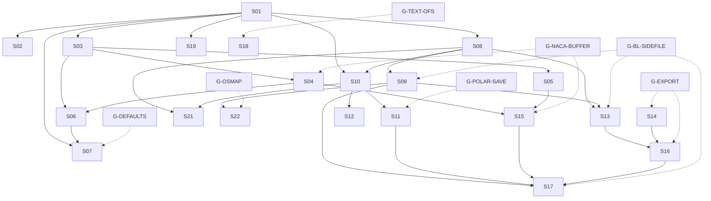

# U6 — XFOIL 6.996 functional integration plan

## Purpose

Plan the dependency-based, stepwise integration of the accepted XFOIL 6.996
source changes into XFOIL.next. The plan turns the U3 groups G01-G13 into small
implementation slices, assigns each slice a target oracle and 6.99 regression
contract, and defines the gates that must be decided before format or product
scope changes. U6 itself changes no C++, Fortran, test, Golden or reference
file.

## Scope

- Cover every U3 group G01-G13 with an implementation slice or an explicit
  non-implementation decision.
- Use the U4 behavior observations as target-behavior evidence.
- Use the U5 byte-reproducible unpatched 6.996 build and the accepted P1
  patched 6.996 build as separate oracle contracts.
- Define the C++ mapping as a slice pre-analysis task; no working mapping is
  invented here.
- Define dependencies, format gates, acceptance tests and the first allowed
  implementation step.
- Keep all existing 6.99 references and goldens canonical until a separate
  migration pass explicitly accepts a change.

## Explicit non-goals

U6 does not:

- change C++ product code;
- change Fortran sources;
- implement another Fortran patch;
- create tests or goldens;
- replace existing references or tolerances;
- change the product version;
- change the banner;
- change the compiler baseline;
- make plot functionality mandatory;
- put the patched binary into `fortran-bin/`;
- correct the polar-save column-order finding as a side effect;
- create a commit or push.

## Accepted source and oracle baselines

### Source baselines

| ID | Baseline | Identity |
|---|---|---|
| `S-699` | XFOIL 6.99 frozen source | 48/48 hashes green |
| `S-6996` | XFOIL 6.996 frozen source | 49/49 hashes green |
| `P-6996-P1` | Repository patch overlay | `patches/xfoil-6.996/0001-rewind-polar-dump-unit-before-header.patch`, SHA-256 `be992f7c48cee137293e15b8fe2dc169b3e5838b5f46c95475b479048cca0572` |

The frozen sources are immutable. The patch is applied only to an external
copy by the build adapter.

### Oracle contracts

| ID | Artifact | Contract |
|---|---|---|
| `O-699` | `fortran-bin/xfoil`, SHA-256 `f5779d6954d0b8fdc152e0e0633f18732e00b7b69228d561d629bd524bba598c` | Canonical 6.99 reference for existing goldens, backward diagnosis and unchanged behavior |
| `O-6996-U` | `fortran-bin/xfoil-6.996`, SHA-256 `000b0468d9a7f4fce42d6fac24bd14147d7d326c8a9035909c8e9f98d180f50e` | Documented unpatched upstream state; reproduces the polar-dump defect; not target behavior |
| `O-6996-P1` | External patched build, SHA-256 `031d667f3990c326b5b90d448fbdd10327b127a4e56d249fd6fcec71b55a69ce`; Build-ID `8d0f4c6c2bfdeb1d945b4b759f69b7915de17dc4`; patch `P-6996-P1` | Case-scoped 6.996 target behavior only; not a blanket canonical oracle |

`P-6996-P1` and `O-6996-P1` are already accepted by
`X6996-U5-P1-R1`; U6 does not re-open the patch decision. The overlay is used
only to obtain case-scoped 6.996 target behavior.

The patched binary is produced by:

```sh
tools/build-xfoil-6.996-oracle.sh \
  --buildroot <external-empty-root> \
  --plotlib-root <external-plotlib-root> \
  --apply-polar-dump-patch
```

The unpatched mode of the same adapter produces `O-6996-U`.

## Reference policy

1. `O-699` remains the canonical reference for existing 6.99 behavior.
2. Existing goldens and references are never replaced by 6.996 output.
3. `O-6996-U` is used only to reproduce and classify the unpatched upstream
   state. It is not a target.
4. `O-6996-P1` is used case by case for accepted 6.996 target behavior.
5. A 6.996 result is first measured externally. A versioned repository
   reference is created only after the owning slice is accepted and a separate
   reference/golden decision explicitly authorizes it.
6. No global "6.996 golden refresh" is permitted.
7. Text-only output changes are assessed separately from numeric output.
8. Open format findings, including the polar-save column order, remain
   `T-PENDING` and cannot be normalized or accepted as a by-product.

## Compatibility policy

- Preserve 6.99 contracts for behavior not owned by the active slice.
- Adopt 6.996 behavior only through an accepted slice with its target oracle.
- Do not hide changed results behind tolerance changes.
- New commands become product-visible only after their kernel and state
  dependencies are accepted.
- New defaults are a separate change and are not activated as a side effect of
  algorithm work.
- File-format changes require explicit migration and roundtrip decisions.
- No global user-facing "6.99 mode" or "6.996 mode" is introduced.
- Windows behavior remains on the existing accepted baseline unless a slice
  explicitly changes a numeric or file contract and performs its manual check.
- The product banner remains `XFOIL.next`; it is not changed to `XFOIL 7`.

## Integration principles

1. One slice handles one coherent change class.
2. Foundations, limits and state layout precede dependent algorithms.
3. New defaults are integrated separately from algorithm changes.
4. File formats are integrated separately from numeric producers.
5. Command/session logic is not mixed with numeric kernel changes.
6. Plot-only changes are not ported.
7. Mixed plot/state routines are examined only for their non-graphical effects.
8. Large result changes are not hidden by tolerances.
9. Existing Windows contracts are not widened globally.
10. Every slice names its 6.99 regression cases and its 6.996 target cases.
11. Golden or format-contract changes require a separate, justified pass.
12. Compiler and toolchain migration remain outside this integration.

## Dependency graph

### Edges

| From | To | Kind | Reason |
|---|---|---|---|
| `S01` | `S02` | hard | spline/solver workspace builds on state limits |
| `S01` | `S03` | hard | geometry capacity and state layout |
| `S01` | `S07` | hard | default state is initialized in the enlarged state |
| `S01` | `S08` | hard | BL state fields use the enlarged layout |
| `S01` | `S10` | hard | polar storage uses the enlarged state |
| `S01` | `S19` | hard | inverse-design state layout |
| `S03` | `S04` | hard | sharp-TE airfoil generation uses normalized geometry |
| `S03` | `S05` | hard | GDES geometry primitives |
| `S03` | `S06` | hard | paneling uses normalized geometry |
| `S04` | `S06` | hard | sharp-TE paneling needs sharp-TE geometry |
| `S04` | `S15` | hard | NACA/NACS command activation |
| `S05` | `S15` | hard | GDES command activation |
| `S06` | `S07` | order | default paneling is accepted after QDCALC work |
| `S08` | `S09` | hard | CFT consumes the BL state/data flow |
| `S08` | `S10` | hard | polar element state consumes BL/state fields |
| `S08` | `S13` | hard | BL dump formats consume BL fields |
| `S08` | `S21` | read-only | plot-only shared-state verification |
| `S09` | `S13` | hard | BL dump formats consume CFT results |
| `S09` | `S17` | hard | session/convergence behavior follows BL results |
| `S09` | `S22` | diagnostic | OSMAP transition producer follows BL behavior |
| `S10` | `S11` | hard | polar text format consumes element state |
| `S10` | `S12` | hard | polar dump consumes element/polar state |
| `S10` | `S21` | read-only | plot-only shared-state verification |
| `S11` | `S17` | hard | session/file state invalidation |
| `S13` | `S16` | hard | BLOU command uses BLDUMP3 |
| `S14` | `S16` | hard | SVG/DXF command uses exporters, if accepted |
| `S15` | `S17` | hard | session behavior after geometry commands |
| `S16` | `S17` | hard | session behavior after export commands |
| `G-POLAR-SAVE` | `S11` | gate | polar-save order decision |
| `G-DEFAULTS` | `S07` | gate | adopt or retain defaults |
| `G-EXPORT` | `S14` | gate | SVG/DXF product scope |
| `G-EXPORT` | `S16` | gate | SVG/DXF command portion only; BLOU uses `S13` independently |
| `G-TEXT-OFS` | `S18` | gate | inviscid OFS text decision |
| `G-NACA-BUFFER` | `S04`, `S15` | gate | 399-point NACA buffer decision |
| `G-BL-SIDEFILE` | `S09`, `S13`, `S17` | gate | automatic `:00.bl` decision |
| `G-OSMAP` | `S22` | gate | OSMAP data/provenance decision |

The graph is acyclic. `G-NACA-BUFFER` and `G-BL-SIDEFILE` gate target
acceptance, not the implementation of the numerical kernel itself.

### Diagram



## Implementation slices

### Slice coverage map

| Group | Slices or decision |
|---|---|
| G01 state, limits and polar metadata | `S01`, `S10`; `NIMP-01` for plot-only `NTS`/`LPPORT` |
| G02 numerics robustness | `S02` |
| G03 geometry normalization | `S03` |
| G04 sharp TE, NACA and GDES geometry | `S04`, `S05`, `S15` |
| G05 paneling and QDCALC | `S06` |
| G06 boundary layer and derivatives | `S08`, `S09`, `S18` |
| G07 defaults | `S07` |
| G08 file formats and exports | `S10`, `S11`, `S12`, `S13`, `S14`, `S16` |
| G09 command and session behavior | `S15`, `S16`, `S17`, `S18`, `S21` for `NSPL` |
| G10 inverse design | `S19` |
| G11 input capacity | `S20` |
| G12 plot-only observations | `S21`, `NIMP-01`; the non-plot `xtcam` text-format portion is `S18` |
| G13 OSMAP | `S22`, diagnostic only until `G-OSMAP` |

G01 state additions are carried with their first consumer rather than forced
into `S01`: `CLF`, `DSSR`, `MDEF`, `PDEF` and `KDEF` are implemented in `S08`;
`CPOLEL`, `KPOL` and `NKPOL` are implemented in `S10`; `NTS` and `LPPORT` are
`NIMP-01`.

### Non-implementation decisions

| ID | Affected upstream scope | Reason | Shared state or producer | Re-evaluation condition |
|---|---|---|---|---|
| `NIMP-01` | Plot-only `NTS`/`LPPORT` state, `NSPL`, `blplot.f`, `polplt.f`, `pplot.f`, `plutil.f`, `xplots.f`, `pntops.f` and the plot parts of `xtcam.f` | No non-graphical product contract is established for these plot-only paths | Read-only polar/BL state (`CPOLSD`, `CPOLEL`, `MDEF`/`PDEF`/`KDEF`); no producer is ported | An accepted product plot contract or a shared-state dependency in `S08`, `S10` or `S18` requires the affected path |
| `NIMP-02` | `SVGOUT`, `DXFOUT`, `SVG`, `DXF` and their file formats | Product scope and format/API ownership are not decided | Geometry arrays and export I/O | `G-EXPORT` accepts inclusion; then `S14`/`S16` are activated |
| `NIMP-03` | `osmap.f`, `ntcalc.f`, `frplot.f`, `getosfile.c` and the `osmap.dat` data path | Data file is missing; format compatibility is unproven; no safe non-graphical trigger is established | `NTCALC`/`FRPLOT` transition producer and the future C++ OSMAP reader | `G-OSMAP` establishes provenance, format and a controlled diagnostic trigger |

### Internal staging of larger slices

No additional top-level slice IDs are introduced. The following slices are
internally staged so that independent effects are not mixed in one commit:

| Slice | Internal stages | Rule |
|---|---|---|
| `S02` | `S02a`: `SEGSPLD`; `S02b`: `NMAX`/`NVX`/`LUDCMP` workspace | `S02a` and `S02b` have separate target cases and may be separate commits; `S02b` must not alter the `S02a` contract |
| `S05` | `S05a`: `SQTE`/`TECIRC`/`CIRC`; `S05b`: `SYTB`/`TGAP` | Separate target cases and commits; no command registration in either stage |
| `S17` | `S17a`: state/invalidation after geometry and file commands; `S17b`: warm starts, sequences, convergence and menu behavior | `S17a` precedes `S17b`; separate target cases and commits; no numeric kernel change |

### Slice index and contract

| Slice ID | U3 groups | Scope | Fortran routines | C++ areas | Dependencies | Risk | Oracle cases | 6.99 regressions | Expected files |
|---|---|---|---|---|---|---|---|---|---|
| `S01` | G01 | Capacity only: `IQX` 370→601, `NPX` 12→20, derived `IWX`/`IBX`/`IZX`/`IVX`, bounds and allocation; no defaults or geometry semantics | `XFOIL.INC` | Core state/limits; mapping in slice pre-analysis | — | high | `a20`, `a21`, `H-S01-IQX-580/600/601/602`, `H-S01-NPX-12/20/21`, `H-S01-NO-PARTIAL-MUTATION`, `H-S01-CONTAINERS`, `H-S01-SESSION-CAPACITY` | `a02`–`a05` | C++ state/limit files and focused tests; no Fortran/Golden |
| `S02` | G02 | `SEGSPLD` segment-end fix; `NMAX` 2500; `NVX` 515; `LUDCMP` workspace; no broad numerics refactor | `spline.f`, `xsolve.f` | Core math/numerics; mapping in slice pre-analysis | `S01` | medium | `H-S02-SEGSPLD`, `H-S02-NMAX-600`, `H-S02-NVX-515`; `a02`, `a05` | `a02`, `a03`, `a05` | Math/numerics C++ and harness; no Fortran/Golden |
| `S03` | G03 | `NORM` chord-vector normalization and shift/scale; `LEFIND`/`XLFIND` robustness; `CANG` ATAN2; `GEOPAR` consistency; no new defaults | `xgeom.f` | Core geometry; mapping in slice pre-analysis | `S01` | high | `H-S03-NORM`; `a02`, `a03`, `a09`, `a11` | `a02`, `a03`, `a11` | Geometry C++ and harness; no Fortran/Golden |
| `S04` | G04 | `NACA4`/`NACA5` `LTES`, `NACA` signature, sharp-TE NACA generation; `NACS` kernel only; no command registration | `naca.f`, `xfoil.f` `NACA` | Core airfoil generation; mapping in slice pre-analysis | `S03` | high | `H-S04-NACA-LTES`; `a22`, `a23` after `S15` | `a02`, `a03` | Airfoil-generation C++ and harness; no command yet |
| `S05` | G04 | `SQTE`, `TECIRC`/`CIRC`, `SYTB`, `TGAP` split geometry; no command registration or plot | `xgeom.f`, `xgdes.f` kernels | Core geometry design; mapping in slice pre-analysis | `S03` | high | `a24`, `a25`, `a26`, `H-S05-TGAP` | `a09`–`a11` | Geometry-design C++ and harness; no command yet |
| `S06` | G05 | `QDCALC` TE-bisector control point and influence matrix; no BL coupling | `xpanel.f` | Core paneling/inviscid; mapping in slice pre-analysis | `S01`, `S03`, `S04` | high | `a02`, `a03`, `a19`, `a22`–`a24`, `H-S06-QDCALC` | `a02`, `a03`, `a19` | Paneling C++ and harness; no Fortran/Golden |
| `S07` | G07 | `NPAN=240`, `CTERAT=0.3` initialization, display and persistence only | `xfoil.f` init/`VPAR`; `WDEF`/`RDEF` | App defaults/session; mapping in slice pre-analysis | `S01`, `S06`, `G-DEFAULTS` | medium-high | `a15`, `a18`, `a19`, `H-S07-OVERRIDE` | `a04`, `a05` | Defaults C++ and focused tests; no commands/formats |
| `S08` | G06 | BL state fields `CLF`, `DSSR`, `MDEF`, `PDEF`, `KDEF`; `xbl.f` data flow/output assignments; no `CFT` change | `xbl.f`, `XFOIL.INC` fields | Core BL state; mapping in slice pre-analysis | `S01` | medium | `a04`, `a05`, `a08`, `a28`, `H-S08-BL-FIELDS` | `a04`, `a05`, `a08` | BL state C++ and harness; no format golden |
| `S09` | G06 | `CFT` clamped `GRT` derivatives; laminar/turbulent/wake behavior; no new BL model | `xblsys.f` | Core BL solver; mapping in slice pre-analysis | `S08` | medium | `H-S09-CFT`; `a04`, `a05` | `a04`, `a05` | BL solver C++ and harness; no Fortran/Golden |
| `S10` | G01 | Polar element metadata `CPOLEL`/`KPOL`/`NKPOL` and related state; `NTS`/`LPPORT` are `NIMP-01` | `PINDEX.INC`, `PPLOT.INC`, `XFOIL.INC` | Core polar state; mapping in slice pre-analysis | `S01`, `S08` | high | `H-S10-POLAR-ELEM`; `a06` | `a06` | Polar-state C++ and harness; no text format yet |
| `S11` | G08 | Polar text read/write/append, element columns and buffers; preserve reader migration; no dump | `iopol.f`, `xpol.f` `PLRSET`/`PLRINI`/`PLRADD` | Core polar IO; mapping in slice pre-analysis | `S08`, `S10`, `G-POLAR-SAVE` | high | `a06`, `H-S11-ROUNDTRIP`; patched `a07` save after `S12` | `a06`, `a12`, `a13` as applicable | Polar IO C++ and roundtrip tests; no Golden migration |
| `S12` | G08 | Polar dump `PLXINI`/`PLXADD` format and patched-oracle contract; no source patch; no save columns | `xpol.f` dump routines; `P-6996-P1` | Core polar/dump IO; mapping in slice pre-analysis | `S08`, `S10` | high | patched `a07`, `H-S12-DUMP` | `a06`, `a08` | Dump IO C++ and compatibility tests; no source changes |
| `S13` | G08 | `BLDUMP2` density-corrected output and `BLDUMP3` format; no `BLOU` command | `xoper.f` `BLDUMP2`/`BLDUMP3`; `xbl.f` fields | Core BL IO/export; mapping in slice pre-analysis | `S08`, `S09` | high | `a08`, `a28`, `H-S13-BLDUMP3` | `a04`, `a05`, `a08` | BL IO C++ and format tests; no command yet |
| `S14` | G08 | SVG/DXF exporter and file format, only if `G-EXPORT` accepts product scope; no plot backend | `xfoil.f` `SVGOUT`/`DXFOUT` | Core export IO; mapping in slice pre-analysis | `S03`, `S04`, `S05`, `G-EXPORT` | conditional | `a29`, `a30`, `H-S14-EXPORT` | `a14` plot baseline; otherwise `NIMP-02` | Export C++ and format tests, or `NIMP-02` |
| `S15` | G09 | Geometry command registration, menus and invalidation for `NACS`, `SQTE`, `CIRC`, `SYTB`, `XCEN`, `Adeg`; `NSPL` excluded | `xfoil.f`, `xgdes.f` dispatcher | App CLI/session; mapping in slice pre-analysis | `S03`, `S04`, `S05` | medium | `a22`–`a27`; `a09`–`a11` | `a09`–`a11` | CLI/session C++ and tests; no formats/defaults |
| `S16` | G09 | `BLOU` command; SVG/DXF command only if accepted; no format implementation | `xfoil.f`/`xoper.f` dispatcher | App CLI; mapping in slice pre-analysis | `S13`; `S14`/`G-EXPORT` for SVG/DXF only | medium | `a28`, `a29`, `a30` | `a08`, `a01` | CLI C++ and tests; conditional export |
| `S17` | G09 | Session state, invalidation, warm starts, sequences, convergence/menu behavior; no new numeric kernel | `xfoil.f` `INIT`, `xoper.f` `OPER`/`VPAR`, `xgdes.f` state | Session/CLI; mapping in slice pre-analysis | `S08`, `S09`, `S11`, `S15`, `S16` | medium | `a01`, `a16`, `a17`, `a33`, `a09`–`a13`, `H-S17-INVALIDATION`, `H-S17-WARMSTART` | `a01`–`a05`, `a09`–`a13` | Session C++ and tests; no formats/defaults |
| `S18` | G09 | Text-only console: `OFS:` decision, `CLf`/`CDp` lines, `xtcam` widths, prompts; no numeric change | `xfoil.f`, `xoper.f`, `xtcam.f` | App text/console; mapping in slice pre-analysis | `S06`, `S09`, `G-TEXT-OFS` | medium-low | `a02`, `a03`, `a04`, `a05`, `a16`, `a17`, `H-S18-TEXT` | relevant text cases | Text-output C++ and tests; no numeric Golden |
| `S19` | G10 | `SMOO` `KQSP=1` target correction; no general inverse refactor | `xmdes.f` `MDES` | Core inverse/CLI; mapping in slice pre-analysis | `S01`, `S03` | medium | `H-S19-SMOO`; `a16` | `a10`, `a16` | Inverse C++ and harness; no Fortran/Golden |
| `S20` | G11 | Input buffer 80/130→256/258 and parse limit 128→256; no grammar change | `userio.f` | App CLI parser; mapping in slice pre-analysis | — | low | `a32`, `H-S20-INPUT-256` | `a01`, `a02`, `a32` | Parser C++ and tests; no format changes |
| `S21` | G12 | Plot-only no-port decision and shared-state checks; `NTS`/`LPPORT`/`NSPL` are `NIMP-01` | `blplot.f`, `polplt.f`, `pplot.f`, `plutil.f`, `xplots.f`, `pntops.f`, `xtcam.f` plot parts | No product mapping; verification only | `S08`, `S10` | low | `a14`, `a31`, `H-S21-SHARED` | `a06`, `a08`, `a28` | No C++; verification record only |
| `S22` | G13 | OSMAP diagnostic/compatibility only; no product implementation before `G-OSMAP`; no data copy | `osmap.f`, `ntcalc.f`, `frplot.f`, `getosfile.c` | OSMAP mapping only after gate | `S09`, `G-OSMAP` | unknown | `H-S22-OSMAP`; `a04`/`a05` untriggered | `a04`, `a05` | Diagnostic record; no data file |

### Slice expected changes, non-goals and commit boundary

| Slice | Expected change | Explicit non-goals | Commit boundary |
|---|---|---|---|
| `S01` | New accepted capacity range; controlled rejection above 601 panels and 20 polars; no partial mutation on rejection; header/container/session capacities checked | No defaults, NACA, sharp TE, QDCALC, commands or formats | One local commit: capacity/state plus focused tests |
| `S02` | Correct segment-end derivatives and larger spline/solver workspaces | No global spline rewrite; no new tolerances | One or two bounded local commits for `S02a`/`S02b` |
| `S03` | Normalization invariance and robust LE/bend geometry | No sharp-TE commands; no defaults | One local commit: geometry primitives and tests |
| `S04` | Sharp-TE NACA generation and `NACA` `LTES` API | No `NACS` command registration; no GDES changes | One local commit: airfoil generation and harness |
| `S05` | New GDES geometry kernels | No command/menu activation; no plot port | One or two bounded local commits for `S05a`/`S05b` |
| `S06` | Correct sharp-TE inviscid influence row | No viscous coupling; no defaults | One local commit: QDCALC and inviscid tests |
| `S07` | Accepted default panel count and TE clustering | No commands, exports or formats; no implicit adoption | One local commit after `G-DEFAULTS`: defaults and tests |
| `S08` | BL state fields and data flow | No `CFT` change; no dump format; no text output | One local commit: BL state and tests |
| `S09` | Correct clamped-GRT derivatives | No new BL model; no format changes | One local commit: CFT and focused BL tests |
| `S10` | Polar element metadata and storage | No text format, dump or commands; no `NTS`/`LPPORT` port | One local commit: polar state and harness |
| `S11` | Accepted polar text contract and append behavior | No dump change; no silent format replacement | One local commit after `G-POLAR-SAVE`: polar IO and roundtrips |
| `S12` | C++ dump path matching the patched 6.996 oracle | No Fortran patch; no polar-save order change | One local commit: dump IO and compatibility tests |
| `S13` | BLDUMP2/3 fields and format | No `BLOU` command; no polar format change | One local commit: BL output and format tests |
| `S14` | SVG/DXF export only if scope accepted | No automatic upstream carry-over; no plot backend | Conditional one local commit; otherwise `NIMP-02` |
| `S15` | Geometry command acceptance and invalidation | No kernels; no formats; no defaults | One local commit: CLI geometry commands and tests |
| `S16` | `BLOU` and accepted export commands | No format implementation; no plot backend | One local commit: CLI export commands and tests |
| `S17` | Session invalidation, warm starts and sequences | No new numerics; no format/default change | One or two bounded local commits for `S17a`/`S17b` |
| `S18` | Accepted text-only console contract | No numeric change; no global golden refresh | One local commit after `G-TEXT-OFS`: text output and tests |
| `S19` | Correct `SMOO` target | No general inverse refactor | One local commit: inverse design and harness |
| `S20` | Larger input/parser capacity | No grammar or command changes | One local commit: parser capacity and tests |
| `S21` | Verified non-port and shared-state safety | No plot implementation | No implementation commit; verification record only |
| `S22` | OSMAP diagnostic decision or deferred status | No data copy; no source changes; no compatibility claim | No implementation commit until `G-OSMAP` |

## Oracle-case mapping

`O-699` cases are the existing 6.99 regression cases. `O-6996-P1` cases are
target cases only after the owning slice. `H-Sxx-*` are planned focused
harness/case IDs; U6 creates no repository test or golden for them. They are
external audit cases until a later implementation pass is authorized.

| Oracle contract | Cases | Use |
|---|---|---|
| `O-699` | `a01`–`a15`, plus existing reference cases relevant to each slice | Byte-identical 6.99 regression and backward diagnosis |
| `O-6996-U` | `a20`, `a21`, `a07` and other defect/limit reproductions | Record the unpatched upstream state; never target acceptance |
| `O-6996-P1` | `a07` patched; case-specific target cases in the slice table | Per-case 6.996 target behavior only |
| `H-S01`–`H-S22` | Focused harness/case IDs listed above | Internal/ external focused verification; no golden until separately authorized |
| `T-PENDING` | Polar save and OSMAP cases affected by open gates | Not accepted, not migrated and not used as a canonical reference |

U4 cases `a02`, `a03`, `a04`, `a05`, `a06`, `a08`, `a09`–`a11`, `a15`,
`a16`, `a18`, `a19`, `a22`–`a33` are the primary reusable evidence set. Cases
not directly observable in U4 (`SEGSPLD`, QDCALC internals, CFT internals,
multi-element polar columns, input capacity, OSMAP) use focused harnesses.

## 6.99 regression policy

- `O-699` remains canonical. Existing 6.99 goldens and references are not
  regenerated or overwritten.
- Every slice runs its named 6.99 regression cases and the relevant existing
  C++ suites before its target behavior is accepted.
- Cases whose expected 6.99 result is intentionally changed by a slice are
  removed from the "unchanged" set only with an explicit slice note. They
  remain available as historical 6.99 references.
- Defaults are pinned explicitly in regression inputs while defaults are not
  the subject of the slice.
- Numeric differences are reviewed and documented, not hidden by a tolerance.
- Text-only changes are reviewed separately from numeric differences.
- A failed 6.99 regression blocks the slice; it is not waived by a 6.996 target
  match.

## 6.996 target-behavior policy

- Use `O-6996-P1` only for the accepted patch overlay; do not use
  `O-6996-U` as target behavior.
- Target cases are case-scoped. A passing patched 6.996 case does not
  automatically promote the patched binary to a global canonical oracle.
- The polar-save column order remains `T-PENDING` until `G-POLAR-SAVE`.
- OSMAP remains `T-PENDING` until `G-OSMAP`.
- The missing automatic `:00.bl` side file remains `T-PENDING` until
  `G-BL-SIDEFILE`.
- The 399-point standard NACA buffer remains `T-PENDING` until
  `G-NACA-BUFFER`.
- New command acceptance and output text are target behavior only in their
  owning command/session slices.
- Every target comparison records exit code, stdout, stderr, generated-file
  set, file hashes and numeric fields appropriate to the slice.

## File-format migration policy

| Area | Slice | Policy |
|---|---|---|
| Polar text save/read/append | `S11` | `G-POLAR-SAVE` required. Decide upstream order, patch contract or retained XFOIL.next format. New format requires reader compatibility, roundtrip and explicit golden migration. |
| Polar dump | `S12` | Use the accepted patched 6.996 oracle; test new, empty, append, cross-read and mismatch cases. No Fortran source patch in the C++ slice. |
| BLDUMP2/BLDUMP3 | `S13` | Field-by-field format contract, roundtrip and a separate version/compatibility decision. No silent replacement of the existing BL dump reference. |
| SVG/DXF | `S14` | Product-scope gate first; then a separate format/API decision and roundtrip tests. No automatic upstream carry-over. |
| Console text | `S18` | Text-only contract; no numeric reference change. `OFS:` and `CLf`/`CDp` decisions are explicit. |
| Input/default persistence | `S07`, `S20` | Capacity and defaults are not format migrations. `WDEF`/`RDEF` persistence needs a roundtrip check if its stored values change. |
| No silent rewrite | all | Existing files are not overwritten in place by a new writer without an explicit compatibility/migration decision. |

## Plot and export scope

- Plot-only changes in `blplot.f`, `polplt.f`, `pplot.f`, `plutil.f`,
  `xplots.f`, `pntops.f`, `xtcam.f` and `NSPL` are not product implementation
  slices. `S21` records the non-port decision.
- Mixed plot/state routines are inspected only for non-graphical state reads
  or numerical producers.
- The external plot library remains the established oracle-build dependency;
  no headless plot backend is made mandatory.
- SVG/DXF are not automatically part of the product. `G-EXPORT` decides; if
  rejected, `S14` and the SVG/DXF part of `S16` become `NIMP-02`.
- No plot backend, cursor behavior or graphical window is required for
  non-graphical acceptance.

## OSMAP policy

- `osmap.f`, `ntcalc.f` and `frplot.f` are source-identical and are not an
  integration target by default.
- No `osmap.dat` is copied into the repository or the 6.996 source set.
- OSMAP format compatibility is unproven. `G-OSMAP` must establish data
  provenance, file format, runtime trigger and control values.
- `S22` is a diagnostic/decision slice, not a product implementation slice.
- OSMAP is not a blocker for S01-S21 outside the OSMAP path, but it remains a
  promotion blocker for a global 6.996 oracle claim.

## Product-version and banner policy

- Product version remains `1.0.0` throughout planning and the early slices.
- `1.1.0` is reserved for a separate release/product-identity pass after the
  defined 6.996 scope is fully integrated and accepted.
- The product banner remains `XFOIL.next`; no rename to `XFOIL 7`.
- No compiler-baseline change is part of this plan.
- The 6.996 banner/version text is target evidence only where a slice owns
  that text behavior; it does not change the product identity globally.

## Test and acceptance matrix

Common commands for affected implementation slices are `make debug`,
`make release`, `make test`, `make test-core`, the relevant
`make test-integration`/`test-regression`/`test-batch` filter,
`make test-harnesses`, `make test-reference` where 6.99 parity is affected, `make test-sanitize`,
and `make test-valgrind` for memory-sensitive slices. The actual target names
are verified in each slice pre-analysis. No numeric test run is required for
U6 itself.

| Slice | Focused | Suite/reference | Linux Debug/Release | Sanitizer/Valgrind | Windows manual |
|---|---|---|---|---|---|
| `S01` | `H-S01` old/new boundary values, rejection, no partial mutation, header/container/session capacity; `a20`, `a21` | `test-core`, relevant `test`, harness capacity | yes | ASan/UBSan and Valgrind required | if state/limit contract changes |
| `S02` | `H-S02` spline/solver | `test-core`, `test-harnesses`, relevant reference | yes | ASan/UBSan and Valgrind required | if numeric contract changes |
| `S03` | `H-S03` geometry | `test-core`, `test-harnesses`, `test-reference` | yes | yes | yes if numeric geometry changes |
| `S04` | `H-S04` NACA | `test-core`, harness, reference | yes | yes | yes for final NACA numeric contract |
| `S05` | `H-S05` GDES geometry | `test-core`, harness, reference | yes | yes | yes for final geometry contract |
| `S06` | `H-S06` QDCALC | `test-core`, harness, reference | yes | yes | yes for final inviscid contract |
| `S07` | `H-S07` defaults | `test-core`, CLI integration, reference | yes | no special requirement | yes for default/geometry contract |
| `S08` | `H-S08` BL fields | `test-core`, harness, reference | yes | yes | yes for BL output |
| `S09` | `H-S09` CFT | `test-core`, harness, reference | yes | yes | yes for BL numeric contract |
| `S10` | `H-S10` polar element state | `test-core`, harness, reference | yes | ASan/UBSan and Valgrind required | if polar state layout changes |
| `S11` | `H-S11` roundtrip | `test-core`, `test-batch`, reference | yes | Valgrind for file paths | yes for file contract |
| `S12` | `H-S12` dump compatibility | `test-core`, `test-batch`, reference | yes | Valgrind for file paths | yes for file contract |
| `S13` | `H-S13` BL dump | `test-core`, `test-batch`, reference | yes | Valgrind for file paths | yes for file contract |
| `S14` | `H-S14` export, if accepted | `test-core`, `test-batch` | yes | Valgrind for file paths | yes for file contract |
| `S15` | `a22`–`a27` command cases | `test-core`, `test-integration`, `test-batch` | yes | no special requirement | yes for command/file behavior |
| `S16` | `a28`–`a30` commands | `test-core`, `test-integration`, `test-batch` | yes | no special requirement | yes for file behavior |
| `S17` | `H-S17` warm starts | `test-core`, `test-integration`, `test-regression` | yes | no special requirement | yes if session/file contract changes |
| `S18` | `H-S18` text | `test-core`, `test-regression`, relevant text suite | yes | no special requirement | yes for final text contract |
| `S19` | `H-S19` SMOO | `test-core`, harness, reference | yes | yes | yes for inverse numeric contract |
| `S20` | `a32`, `H-S20` input | `test-core`, parser suite, `test-batch` | yes | ASan/UBSan and Valgrind required | if input contract changes |
| `S21` | `a14`, `a31`, `H-S21` | verification only, no product tests | yes, unchanged | no | no |
| `S22` | `H-S22` OSMAP diagnostic | diagnostic only until `G-OSMAP` | diagnostic | as required by diagnostic | no |

The exact suite filter and slice-specific test names are established in each
slice pre-analysis. This matrix defines the minimum, not an excuse to skip a
broader suite when the slice changes a shared contract.

## Commit and publication policy

- U6 creates no commit; it adds only the two U6 documents.
- Each later slice produces one or a few clearly bounded local commits.
- Tests and slice documentation are committed with the slice; no unrelated
  cleanup is mixed in.
- Goldens, reference files or format migrations require a separate, explicit
  pass and are not included in an ordinary slice commit.
- No push, force-push, fetch, tag, release or history rewrite is allowed.
- All local commits remain unpushed until cumulative XFOIL.next 1.1.0
  acceptance.

## Open decisions

| ID | Decision | Options | Blocks / affects |
|---|---|---|---|
| `G-POLAR-SAVE` | Polar-save header/data column order | Accept upstream 6.996 order; treat as defect and use a patch contract; retain existing XFOIL.next format | `S11`, polar references and any format migration |
| `G-EXPORT` | SVG/DXF product scope | Include non-graphical export; exclude and record `NIMP-02`; defer | `S14`, SVG/DXF part of `S16` |
| `G-DEFAULTS` | Adopt `NPAN=240`/`CTERAT=0.3` | Adopt as product defaults; retain 6.99 defaults; expose explicit diagnostic setting | `S07` |
| `G-TEXT-OFS` | Inviscid `OFS:` line and related text | Retain 6.99 line; adopt 6.996 removal; preserve via a separate compatibility option | `S18` |
| `G-NACA-BUFFER` | Standard NACA buffer 245→399 points | Intended target; side effect; separate compatibility decision | `S04`, `S15` target acceptance |
| `G-BL-SIDEFILE` | Automatic `:00.bl` side file | Retain 6.99 file; adopt 6.996 absence; replace with an explicit export contract | `S09`, `S13`, `S17` |
| `G-OSMAP` | OSMAP data provenance/format | Proven 6.99 compatibility; new data contract; defer | `S22` |
| `G-PLOT-HEADLESS` | Headless plot backend | Keep external plot library; prove a stub; defer | `S21`, CI/build scope |
| `G-WINDOWS` | Windows contract per slice | Manual validation when numeric/file contracts change | any changed numeric/file slice |

## Exact first implementation step

`X6996-S01-Limits-and-State-Capacity`

`S01` is the only first implementation step released by U6. It covers:

- `IQX` 370→601;
- `NPX` 12→20;
- derived workspace/array capacities and bounds;
- values above the old limit and within the new limit;
- controlled rejection above the new limits;
- no partial mutation when a rejection occurs;
- no out-of-bounds access.

Required focused tests are:

- existing standard cases `a02`–`a05`;
- `H-S01-IQX-580/600/601` for values above the old and inside the new limit;
- `H-S01-IQX-602` for controlled rejection above the new limit;
- `H-S01-NPX-12/20/21` for polar storage acceptance/rejection;
- `H-S01-NO-PARTIAL-MUTATION` after failed capacity requests;
- `H-S01-CONTAINERS` and `H-S01-SESSION-CAPACITY` for affected header,
  container and session capacities;
- ASan/UBSan, Valgrind and the existing 6.99 regression suite.

The CLI may retain its documented clamping path where 6.996 clamps rather than
rejects; the underlying capacity API must reject without partial mutation.

It excludes defaults, NACA point counts, sharp-TE algorithms, QDCALC,
boundary-layer numerics, commands, formats and Golden changes.

`IQX` and `NPX` may be split into `S01a`/`S01b` only if the slice pre-analysis
proves they cannot be changed safely together. U3 does not establish such a
conflict; the default is one `S01` slice.

The first slice must pass its focused capacity cases, the existing 6.99
regression cases, Linux Debug/Release, ASan/UBSan and Valgrind before any
dependent slice starts.
